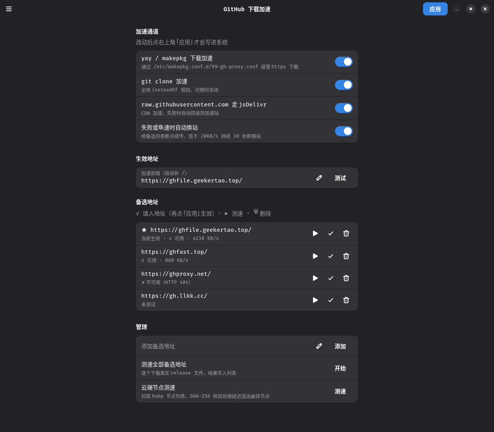

# gh-proxy-manager

[中文](#中文) | [English](#english)

---

<a id="中文"></a>
## 中文

用 **Rust + GTK4** 完全重写的 GitHub 下载加速管理器（v3.0.0）。

旧版是一个 700 行的 Bash + yad/zenity 脚本；新版把“状态探测 / 配置生成 / 提权执行 /
测速”拆成可单元测试的库，CLI 与原生 GTK4 界面共用同一套逻辑。
磁盘布局与 2.x **完全一致**，装上即可接管现有配置，无需迁移。

本仓库：<https://github.com/pingod/gh-proxy-manager> ·
原始 2.x Bash 版本：<https://github.com/Duter2016/gh-proxy-manager>

### 解决什么问题

`yay -Syu` 升级 AUR 软件时，PKGBUILD 里写死的 `https://github.com/.../releases/download/...`
在部分网络下极慢甚至超时。本工具通过 makepkg 的 DLAGENT 覆盖与 git 的 `insteadOf`
规则，让 GitHub 下载自动走加速站，并提供一个界面随时开关、换站、测速。

### 特性

- **yay/makepkg 加速**：独立 `/etc/makepkg.conf.d/99-gh-proxy.conf`，不碰主配置
- **git clone 加速**：一键启停全局 `url.<前缀>.insteadOf` 规则，只动值恰为
  `https://github.com/` 的规则，绝不碰你其它的 `insteadOf`
- **真实测速**：直接下载 release 文件并显示 KB/s，暴露“raw 能通但 release 404/限速”的坏站
- **云端节点测速**：拉取 hubp 节点列表，32 并发测速，用固定图标的 SHA-256 校验节点
  是否被篡改，只保留通过校验的节点，结果缓存 2 小时
- **链接规范化**：`codeload.github.com/.../zip/ref` 自动还原成
  `github.com/.../archive/ref.zip`，`/blob/` 还原成 `/raw/`；release / archive /
  raw / gist 链接全部识别
- **自动换站**：失败或 <20KB/s 持续 30s 时，按备选列表断点续传换下一站（可开关）
- **可选 jsDelivr**：`raw.githubusercontent.com` 走 CDN，失败自动回退加速站
- **开关零残留**：关闭即恢复直连；`reset` 一条命令清理运行时文件
- **原生界面**：GTK4 + libadwaita，单窗口完成所有操作，密码只在本次提权使用
- **CLI 全覆盖**：界面里的每个功能都有对应子命令，可脚本化
- **安全**：提权脚本 0600 临时文件、密码只走 stdin、写完回读校验

### 截图



### 安装

#### Arch Linux（PKGBUILD）

```bash
git clone https://github.com/pingod/gh-proxy-manager.git
cd gh-proxy-manager
makepkg -f
sudo pacman -U gh-proxy-manager-3.0.0-1-x86_64.pkg.tar.zst
```

依赖（运行）：`gtk4` `libadwaita` `curl` `git`；构建：`cargo` `rust`。

#### 从源码（不打包）

```bash
cargo build --release
sudo install -Dm755 target/release/gh-proxy-manager /usr/bin/gh-proxy-manager
sudo install -Dm644 assets/io.github.duter2016.GhProxyManager.desktop \
  /usr/share/applications/io.github.duter2016.GhProxyManager.desktop
```

#### 无图形界面的机器

```bash
cargo build --release --no-default-features   # 只编译 CLI，不依赖 GTK
```

### 使用（图形界面）

应用菜单「GitHub 下载加速管理」，或运行 `gh-proxy-manager gui`：

- 勾选要开启的通道，确认加速地址，点右上角「应用」
- 「备选地址」里：✓ 填入地址、▶ 测速、🗑 删除；下方可添加新地址、一键测速全部

### 使用（命令行）

```bash
gh-proxy-manager status                 # 当前状态 + 备选列表
gh-proxy-manager on / off               # yay/makepkg 加速
gh-proxy-manager git-on / git-off       # git clone 加速
gh-proxy-manager jsdelivr on|off        # raw.githubusercontent.com 走 jsDelivr
gh-proxy-manager failover on|off        # 自动换站
gh-proxy-manager use https://ghfast.top/ # 切换生效前缀（别名 url）
gh-proxy-manager add <URL> / del <URL>  # 维护备选列表
gh-proxy-manager proxies                # 列出备选地址与测速结果
gh-proxy-manager test [--all]           # 真实 release 文件测速
gh-proxy-manager nodes [--refresh] [--json] # 云端节点测速 + SHA-256 完整性校验
gh-proxy-manager auto [--dry-run]       # 自动选最快节点并设为生效地址
gh-proxy-manager resolve <url>          # 查看链接会被怎样改写（不下载）
gh-proxy-manager region                 # 检测出口地区（别名 where）
gh-proxy-manager get <url> [-o 文件]    # 按当前配置下载（额外参数原样传给 curl）
gh-proxy-manager log [-n 50]            # 调试日志
gh-proxy-manager reset [--yes] [--purge]# 卸载清理
```

下载任意 GitHub 链接（等价于旧版 `ghcurl` 函数）：

```bash
gh-proxy-manager get https://github.com/xxx/yyy/releases/download/v1/file.tar.gz
```

### 工作原理

| 通道 | 落地方式 |
| --- | --- |
| yay / makepkg | 写入 `/etc/makepkg.conf.d/99-gh-proxy.conf`，把 https DLAGENT 指向 `/usr/local/bin/curl-gh` |
| curl-gh | 读取 `/etc/gh-proxy/prefix`，按「生效站 → 备选列表」逐个尝试；失败/龟速换站并断点续传；已带前缀的 URL 原样透传 |
| git clone | 全局 `url.<前缀>https://github.com/.insteadOf = https://github.com/` |
| raw + jsDelivr | `/etc/gh-proxy/jsdelivr` 存在时优先 `cdn.jsdelivr.net/gh/user/repo@branch/path`，失败回退加速站 |
| 自动换站开关 | `/etc/gh-proxy/nofailover` 存在 = 关闭（默认开启） |

所有 root 操作合并成一个脚本、一次提权；执行完回读磁盘校验，失败会明确报错而不是静默成功。

### 从 GitHub Accelerator 用户脚本迁移的能力

浏览器扩展 [hubporg/ghproxy-extension](https://github.com/hubporg/ghproxy-extension)
的用户脚本里，与“下载本身”相关的协议层被移植进了 Rust：

| 能力 | 实现 |
| --- | --- |
| 链接识别 | release / latest download / archive / raw / codeload / raw.githubusercontent / gist raw |
| 规范化 | codeload `zip\|tar.gz` → `github.com/.../archive/ref.ext`；`/blob/` → `/raw/` |
| 节点源 | `hubp.tbedu.top/nodes.json`，拉取失败时使用内置兜底节点 |
| 测速 | 32 并发下载固定图标，计算 SHA-256 并与云端期望值比对，不符直接淘汰 |
| 选择 | 按延迟升序取最快节点，结果缓存 2 小时；`auto` 会把校验通过的节点并入备选列表 |
| 地区 | Cloudflare trace → ipapi.is → ip.sb，判断是否位于中国大陆 |

浮标、点击拦截、倒计时和匿名统计属于浏览器扩展形态，没有迁移；本工具在系统层
（makepkg / git / curl）生效，不需要浏览器。

### 与 2.x 的兼容性

以下路径与格式未变，新版直接复用旧数据：

```
/etc/gh-proxy/prefix · jsdelivr · nofailover
/etc/makepkg.conf.d/99-gh-proxy.conf
/usr/local/bin/curl-gh
~/.config/gh-proxy-manager/{proxies,results,nodes.json,debug.log}
```

旧 `proxies` 里的脏行、缺末尾 `/` 的地址会在读取时被清洗；`results` 的测速缓存继续可用。
从 2.x 升级只需要替换二进制。

### 相对 2.x 的修复

- `curl-gh <url>` 手工调用不再把 URL 传两次（旧版会让 `-o` 绑到错误的 URL 上）
- jsDelivr 转换保留分支（`@branch`），旧版丢掉分支段、只能命中默认分支
- jsDelivr 失败不再 `exec` 卡死，自动回退加速站、再回退直连
- 状态判定与写入校验完全基于磁盘实际内容，不再依赖界面输出格式
- CLI 与 GUI 共用同一套逻辑，界面解析问题不会再导致“应用了但没生效”

### 开发

```bash
cargo test          # 50 个单元测试 + 18 个端到端测试
cargo clippy --all-targets -- -D warnings
cargo fmt --check
```

端到端测试不需要 root，也不会碰真实系统——测试用的环境变量：

| 变量 | 作用 |
| --- | --- |
| `GHPM_SYSROOT` | 把 `/etc`、`/usr/local` 前缀搬到临时目录；设置后不提权 |
| `GHPM_GIT_CONFIG` | 让 `git config` 的全局读写指向临时文件 |
| `GHPM_TEST_URL` | 覆盖测速目标（默认 hyperfine 的 release 文件） |
| `GHPM_NODES_URL` | 覆盖云端节点列表地址（测试用） |
| `GHPM_NODE_TEST_URL` | 覆盖节点测速文件 |
| `GHPM_ICON_HASH_URL` | 覆盖节点完整性校验值的来源 |
| `GH_PROXY_CONF_DIR` | `curl-gh` 的配置目录（默认 `/etc/gh-proxy`，测试用） |

源码结构：

```
src/
├── paths.rs      磁盘布局（与 2.x 一致）
├── state.rs      从磁盘推导真实状态
├── mirrors.rs    地址规范化 / jsDelivr 转换 / 备选列表 / 结果缓存
├── gitcfg.rs     insteadOf 规则解析与同步（纯函数计划 + 执行）
├── apply.rs      生成 root 脚本 → 提权 → 同步 git → 回读校验
├── exec.rs       sudo / pkexec / 沙箱执行
├── probe.rs      curl 实测速度
├── cli.rs        clap 命令行
├── gui/          GTK4 + libadwaita 界面
assets/           curl-gh.sh、DLAGENT 配置、桌面文件、图标（编译期内嵌）
tests/cli_flow.rs 真实二进制的端到端测试
```

### 安全模型

- root 脚本写入 0600 的临时文件后交给 `sudo -S` 执行，密码只出现在 stdin，不进命令行/环境变量
- 只写自己的文件，绝不修改 `/etc/makepkg.conf`、不删除未知文件
- 所有拼进 shell 的路径/地址都经过单引号转义（见 `shell::quote` 的测试）
- 写入后回读校验，失败会明确提示并把细节记进 `debug.log`
- 工具本身不保存任何凭据；加速地址只用于拼接 GitHub URL

### 卸载

```bash
sudo pacman -R gh-proxy-manager
/var/lib/gh-proxy-manager/uninstall-cleanup.sh
# 或（源码安装时）：
gh-proxy-manager reset --yes [--purge]   # --purge 连同 ~/.config/gh-proxy-manager 一起删
```

### 许可证

MIT。界面与实现为本项目重写；原始 Bash 版本同样以 MIT 发布，版权归 Donghui。

---

<a id="english"></a>
## English

A complete **Rust + GTK4** rewrite (v3.0.0) of the GitHub download acceleration
manager for Arch Linux. The old version was a 700-line Bash + yad script; this
rewrite splits state detection, config generation, privilege escalation and
speed testing into a testable library shared by the CLI and a native GTK4 UI.

This repository: <https://github.com/pingod/gh-proxy-manager> ·
original 2.x Bash version: <https://github.com/Duter2016/gh-proxy-manager>

**The on-disk layout is identical to 2.x**, so it takes over an existing
installation without migration.

### Features

- yay/makepkg acceleration via `/etc/makepkg.conf.d/99-gh-proxy.conf`
  (main makepkg config untouched)
- One-click global git `insteadOf` rule; only rules whose value is exactly
  `https://github.com/` are touched
- Real speed tests: downloads an actual release file and reports KB/s, exposing
  mirrors that work for raw files but 404/throttle releases
- Cloud node speed test: fetches the hubp node list, tests 32 nodes in parallel,
  and verifies each response against a fixed icon's SHA-256; results cached for 2 h
- Link canonicalization: `codeload.github.com/.../zip/ref` is rewritten to
  `github.com/.../archive/ref.zip`, `/blob/` to `/raw/`; release, archive, raw
  and gist links are all recognized
- Auto-failover: retries the next mirror with resume on failure or when speed
  stays below 20 KB/s for 30 s (toggleable)
- Optional jsDelivr CDN for `raw.githubusercontent.com`, with fallback
- Clean off: disabling restores direct downloads; `reset` removes runtime files
- Native GTK4/libadwaita window; a single privilege escalation per apply
- Full CLI; every UI action has a subcommand
- Root script as a 0600 temp file, password via stdin, write-then-verify

### Screenshot


### Install

```bash
git clone https://github.com/pingod/gh-proxy-manager.git
cd gh-proxy-manager
makepkg -f
sudo pacman -U gh-proxy-manager-3.0.0-1-*.pkg.tar.zst
```

From source:

```bash
cargo build --release
sudo install -Dm755 target/release/gh-proxy-manager /usr/bin/gh-proxy-manager
```

CLI-only build (no GTK): `cargo build --release --no-default-features`.

Runtime dependencies: `gtk4` (≥ 4.10), `libadwaita` (≥ 1.7), `curl`, `git`.

### Usage

```bash
gh-proxy-manager                 # open the GUI when a display is available
gh-proxy-manager on | off        # yay/makepkg channel
gh-proxy-manager git-on|git-off  # git clone channel
gh-proxy-manager jsdelivr on|off
gh-proxy-manager failover on|off
gh-proxy-manager use <prefix>    # active mirror prefix
gh-proxy-manager add/del <url>   # mirror pool
gh-proxy-manager status | proxies | test [--all] | log
gh-proxy-manager nodes [--refresh] [--json]  # cloud node test + SHA-256 verification
gh-proxy-manager auto [--dry-run]            # pick the fastest verified node
gh-proxy-manager resolve <url>               # show the rewritten URL, no download
gh-proxy-manager region                      # egress region (alias: where)
gh-proxy-manager get <github-url> [curl args...]
gh-proxy-manager reset [--yes] [--purge]
```

### How it works

| Channel | Mechanism |
| --- | --- |
| yay/makepkg | DLAGENT override, https downloads go through `/usr/local/bin/curl-gh` |
| curl-gh | tries the active prefix, then the mirror list, switching on failure/slow speed with resume; already-prefixed URLs pass through |
| git clone | global `url.<prefix>https://github.com/.insteadOf` rule |
| raw + jsDelivr | rewrites to `cdn.jsdelivr.net/gh/user/repo@branch/path`, falls back on failure |
| failover switch | `/etc/gh-proxy/nofailover` marker disables it |

All root work is one script and one escalation, followed by a read-back
verification so silent failures are impossible.

### Migrated from the GitHub Accelerator userscript

The protocol layer of the [hubporg/ghproxy-extension](https://github.com/hubporg/ghproxy-extension)
userscript has been ported to Rust:

| Capability | Implementation |
| --- | --- |
| Link matching | release / latest download / archive / raw / codeload / raw.githubusercontent / gist raw |
| Canonicalization | codeload `zip\|tar.gz` → `github.com/.../archive/ref.ext`; `/blob/` → `/raw/` |
| Node source | `hubp.tbedu.top/nodes.json`, with built-in fallback nodes |
| Speed test | 32-way parallel download of a fixed icon, SHA-256 compared to the cloud value; mismatches are dropped |
| Selection | lowest latency wins, cached for 2 h; `auto` merges verified nodes into the mirror list |
| Region | Cloudflare trace → ipapi.is → ip.sb, reports mainland China vs. elsewhere |

The floating badge, click interception, countdown and anonymous stats are
browser-extension features and are intentionally not ported. This tool works at
the system level (makepkg / git / curl) without a browser.

### Differences from 2.x

- `curl-gh <url>` no longer passes the URL twice (2.x broke `-o` on direct calls)
- jsDelivr rewrite keeps the branch (`@branch`) instead of silently dropping it
- jsDelivr failure falls back to mirrors and then direct connection, instead of `exec`
- State detection and post-write verification use the real files on disk
- CLI and GUI share one implementation, so UI parsing can no longer cause
  "applied but not actually enabled"

### Development

```bash
cargo test        # 50 unit + 18 end-to-end tests, no root required
cargo clippy --all-targets -- -D warnings
cargo fmt --check
```

Test hooks: `GHPM_SYSROOT` (relocate `/etc` + `/usr/local` into a temp dir and
skip privilege escalation), `GHPM_GIT_CONFIG` (isolate global git config),
`GHPM_TEST_URL` (override the speed-test target), `GHPM_NODES_URL` /
`GHPM_NODE_TEST_URL` / `GHPM_ICON_HASH_URL` (point cloud node testing at a local
server), `GH_PROXY_CONF_DIR` (where the installed `curl-gh` looks for its config).

### Uninstall

```bash
sudo pacman -R gh-proxy-manager
/var/lib/gh-proxy-manager/uninstall-cleanup.sh
# or: gh-proxy-manager reset --yes [--purge]
```

### License

MIT. Rewritten from the original Bash implementation by Donghui, also MIT.